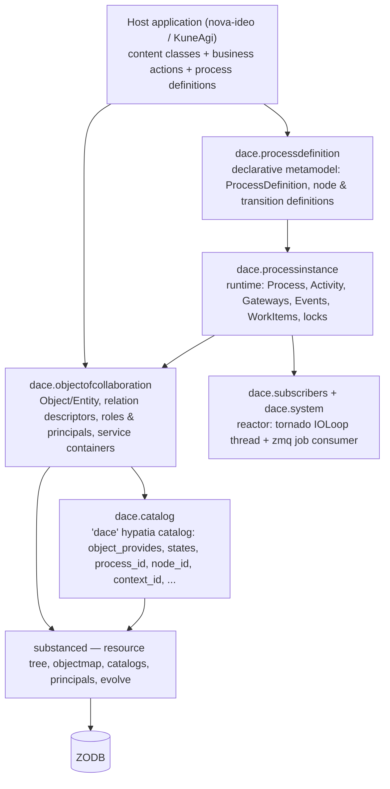
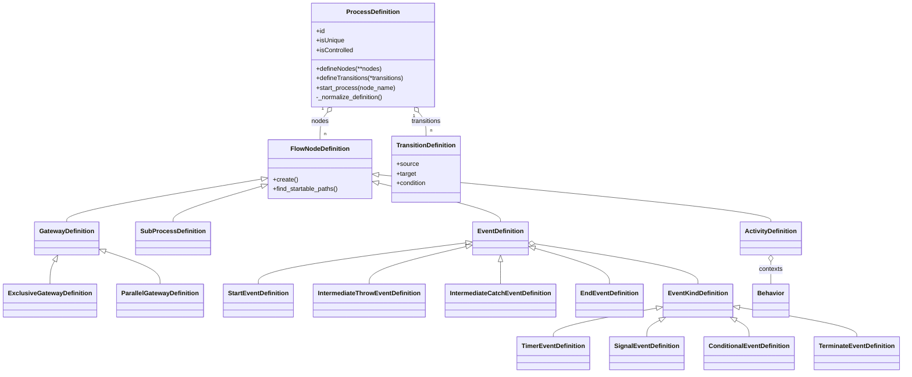
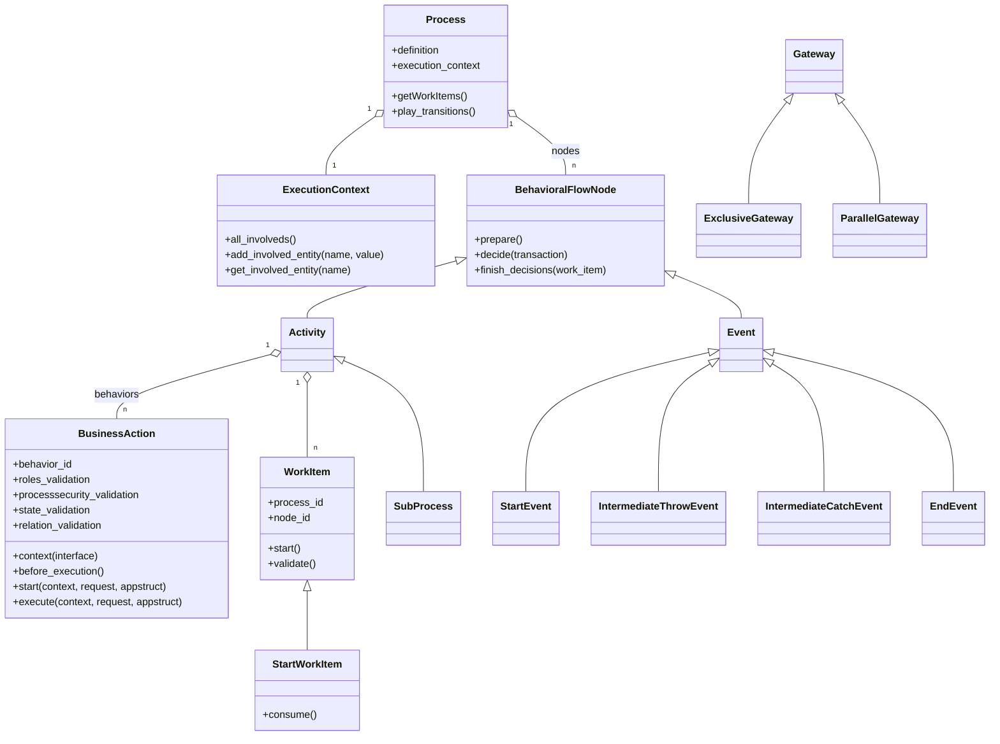
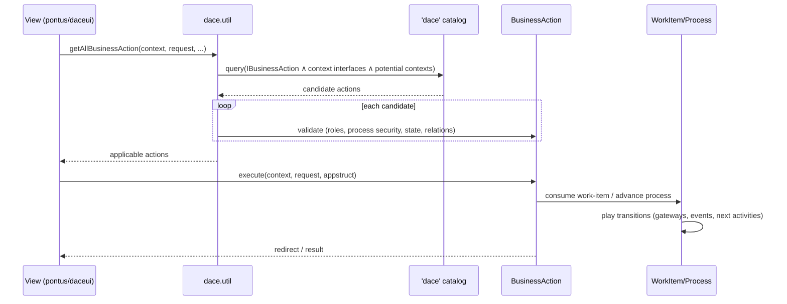
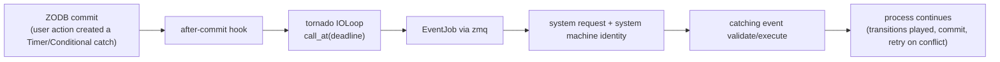

# DaCE — architecture and design

*Design document, Phase 2 of the modernisation roadmap. Describes the engine **as it is** in the legacy code base (Python 3.6 era); modernisation targets are flagged inline. French version: [`../fr/architecture.md`](../fr/architecture.md).*

## 1. What DaCE is

DaCE is a **data-centric workflow engine**: business processes are described declaratively in Python (a BPMN-like metamodel of activities, gateways, events and transitions), instantiated and executed against **collaboration objects** (the domain content: an idea, a proposal, a user…), persisted in the **ZODB** through substanced, and discovered/queried through a dedicated **hypatia catalog**. A small **reactor** (tornado IOLoop + zmq worker, both scheduled for replacement by `asyncio` in Phase 3) wakes the engine up for time-based and conditional events and for system processes.

The engine's signature trait — and the reason nova-ideo's UI feels "alive" — is that **the available actions on any object are computed by the engine**, not hard-coded in views: a view asks *"which business actions apply to this object, for this user, in this state?"* and renders whatever comes back.

## 2. The layers

**Wiring.** `pyramid.includes = dace` triggers `dace.includeme(config)`: a `config.scan()` (which registers process definitions and catalog adapters declared with venusian decorators), the inclusion of `dace.system` (which subscribes `start_ioloop` to `IDatabaseOpenedWithRoot`, i.e. the reactor starts when the ZODB is opened), and the registration of the **evolve steps** (`process_definitions_evolve`, `update_catalogs_evolve`, `remove_unique_process_instances_evolve`, relation-catalog cleanup) used for schema/definition migrations via substanced's evolve mechanism.

## 3. The metamodel (definition side)

Process definitions are plain Python, built at import time and synchronised into the site at startup/evolve (`root['process_definition_container']`).

Notes grounded in the code:

- Node identifiers are the **keyword names** passed to `defineNodes(...)`; transitions reference them by name (`TransitionDefinition('s', 'g1')`).
- `_normalize_definition()` runs when a definition is registered: missing start/end events are normalised, orphan nodes detected — a definition is always well-formed at runtime.
- `isUnique` marks singleton processes (typically **system processes**); the `remove_unique_process_instances_evolve` step purges their stale instances on migration.
- `EventKindDefinition` carries the event semantics: `TimerEventDefinition` (a deadline computed by a callable), `ConditionalEventDefinition` (a predicate re-evaluated by the reactor), `SignalEventDefinition` (thrown/caught by reference), `TerminateEventDefinition`.
- `InclusiveGateway` exists as a **stub** (`pass`) in the runtime: only exclusive and parallel gateways are implemented. Any documentation or model implying inclusive-gateway support is aspirational.

## 4. The runtime (instance side)

Key mechanics:

- **`Transaction` (in `dace.processdefinition.core`) is *not* a database transaction.** It is the engine's path-execution bookkeeping: which paths through the graph are open, which sub-transactions a gateway forked, which decisions are pending. Renaming it (e.g. `PathTransaction`) is a Phase-3 candidate precisely because the homonymy with `transaction`/ZODB is a recurring source of confusion.
- **`StartWorkItem` is virtual**: before a process instance exists, the engine computes *startable paths* from the definitions and materialises them as start work-items. `consume()` instantiates the actual `Process` and replays the chosen path. This is why a user can see and trigger the "create an idea" action while no `ideamanagement` process instance exists yet.
- **Gateways**: `ParallelGateway.find_executable_paths` forks/joins paths; `ExclusiveGateway` produces `UserDecision`s — alternative paths offered simultaneously, where consuming one **cancels the siblings** (`finish_decisions`).
- **`ExecutionContext`** records the entities *involved in* / *created by* a process instance (with history and sub-contexts for sub-processes) — the raw material of the "process history" popup rendered by daceui.
- **Locking** (`dace.processinstance.lock`, plus the `substanced.locking` patch): prevents two users from consuming the same decision/work-item concurrently.

## 5. Business actions: discovery, security, execution

A business action (`BusinessAction`, usually via its `InfiniteCardinality` / `ElementaryAction` / `LimitedCardinality` flavours) binds a **behavior** to an activity of a process, applicable to a **context interface** (e.g. `Iidea`), guarded by up to four validators:

| Validator | Question it answers |
|---|---|
| `roles_validation` | does the current user hold the required (possibly context-local) roles? |
| `processsecurity_validation` | do the process-level rules allow it (quotas, site configuration, ownership…)? |
| `state_validation` | is the context in a compatible state (`'to work' in context.state`…)? |
| `relation_validation` | are the required relations between process and context in place? |

Discovery is **catalog-driven**. `dace.util.getAllBusinessAction(context, request, process_id=, node_id=, isautomatic=, action_type=…)` queries the `'dace'` catalog: `object_provides = IBusinessAction` ∧ `context_id ∈ interfaces provided by the context (full IRO)` ∧ `potential_contexts_ids ∈ {'any', oid(context)}`, then runs the validators on each candidate. The indexed views (`DaceCatalogViews`) expose `process_id`, `node_id`, `states`, `isautomatic`, `issystem`, `context_provides`, … which is also what makes daceui's panels and nova-ideo's screens cheap to render.

`ActionType` distinguishes **manual** actions (rendered as buttons/forms), **automatic** ones (run by the engine when reached) and **system** ones (run by the reactor under the system machine identity).

## 6. Events and the reactor

Time-based and conditional behaviour rests on three cooperating pieces (all in `dace.subscribers`, `dace.processinstance.event`, `dace.util`):

- a **tornado IOLoop** running in a dedicated thread (poll timeout patched to 0.2 s in `dace.patches`), started on `IDatabaseOpenedWithRoot`;
- a **zmq-fed job consumer** (`ConsumeTasks` thread): engine work triggered outside a user request is wrapped in a `Job`/`EventJob` (from `dace.util`), which sets up its own request/site, executes under the **system machine** identity, commits, and **retries on ZODB conflicts**;
- **after-commit scheduling**: `push_event_callback_after_commit(event, callback, params, deadline)` registers a ZODB after-commit hook, so an event is only armed once the data that created it is durably committed — then the callback is scheduled on the IOLoop at its deadline.

On application restart, `start_intermediate_events` re-arms the pending catching events found in the database — deadlines survive restarts. `SIGINT`/`SIGTERM` handlers stop the loop and the consumer cleanly.

**Phase 3 note.** This entire reactor is the designated replacement target: tornado < 4 and pyzmq 14 are the oldest moving parts of the stack. The migration plan is `asyncio` behind the *same* API surface (`push_event_callback_after_commit`, `Job`/`EventJob`, `start_ioloop`/`stop_ioloop`), validated by the existing signal/timer tests.

## 7. Collaboration objects, relations, roles

- `Object(Folder)` marries the substanced resource tree with **declarative relation descriptors** (`dace.descriptors`): `CompositeUniqueProperty`, `CompositeMultipleProperty`, `SharedUniqueProperty`, `SharedMultipleProperty`. *Composite* implies containment/lifecycle ownership; *shared* is a reference; both maintain the **opposite** end automatically and are manipulated uniformly through `getproperty` / `setproperty` / `addtoproperty` / `delfromproperty`. `set_data`/`get_data` bridge colander appstructs to properties (the pontus form layer relies on it).
- `Entity(Object)` adds `state` (a `PersistentList` — an entity can be in several states at once, e.g. `['submitted_support', 'published']`) and the dynamic `actions` property.
- **Roles** (`dace.objectofcollaboration.principal.util`): `grant_roles`/`revoke_roles`/`has_role` support *global* roles and *context-local* roles (`('Owner', obj)`), a superior/inferior hierarchy (`_get_allsuperiors`), and `get_access_keys(user)` — the pre-computed keys used by catalog queries to filter what a user may see at scale.

## 8. Persistence, evolution, monkey-patches

- Everything is a persistent object in the ZODB; module **dotted names are frozen** across the modernisation to keep existing pickles loadable.
- **Evolve steps** shipped by `dace/__init__.py` handle definition changes: `process_definitions_evolve` re-synchronises `root['process_definition_container']` with the code (and warns, in its log message, that an application **restart is mandatory** afterwards to fix `node_definition` back-references on content classes), then re-runs `update_catalogs_evolve` (index updates + reindex).
- `dace/patches.py` carries exactly **three** monkey-patches, all performance/latency motivated: tornado's poll timeout lowered to 0.2 s (event reactivity); `substanced.objectmap.ObjectMap._find_resource` replaced by a direct BTree walk (the original went through `pyramid.traversal`, creating a Request per lookup); `substanced.locking._get_lock_service` short-circuited through dace's `find_service`. They are documented in the module itself and must be re-evaluated when the substanced fork lands (Phase 3).

## 9. Reading map

| To understand… | Read |
|---|---|
| the metamodel | `processdefinition/processdef.py`, `core.py`, `eventdef.py` |
| path execution & decisions | `processinstance/core.py` (`Transaction`, `MakerFlowNode`), `gateway.py`, `workitem.py` |
| business actions | `processinstance/activity.py`, `util.py` (`getAllBusinessAction`) |
| the reactor | `subscribers.py`, `processinstance/event.py`, `util.py` (`Job`/`EventJob`), `patches.py` |
| domain objects & relations | `objectofcollaboration/object.py`, `entity.py`, `descriptors/` |
| roles & visibility | `objectofcollaboration/principal/util.py`, `catalog/__init__.py` |
