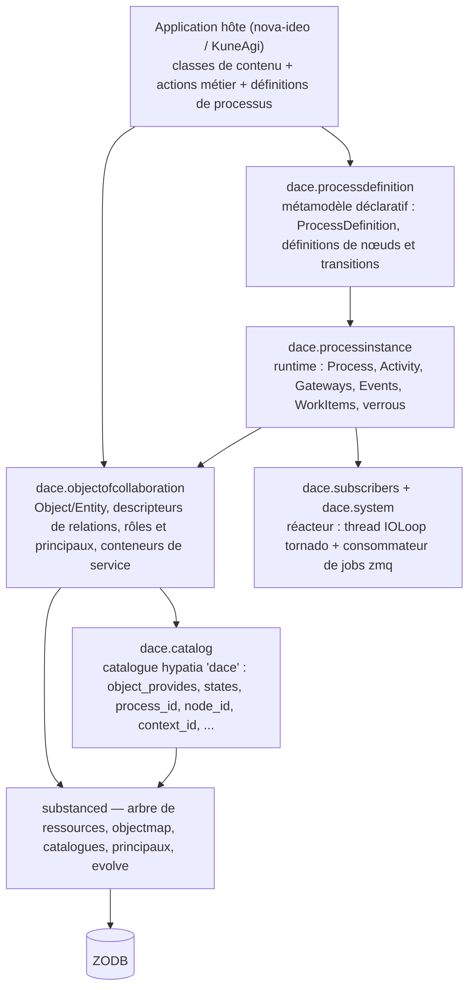
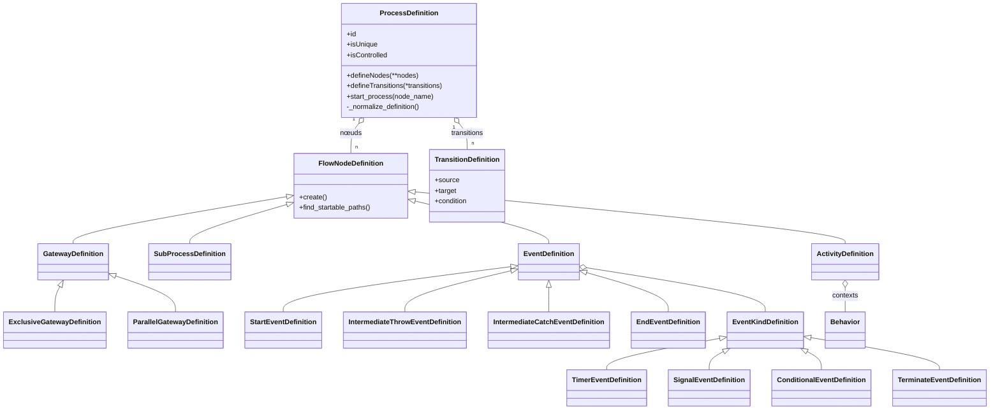
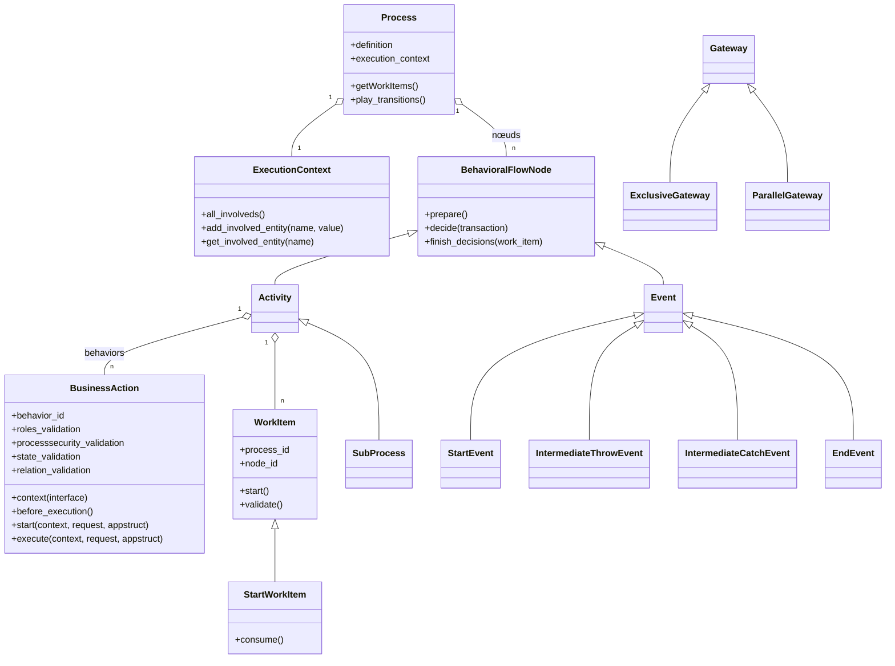
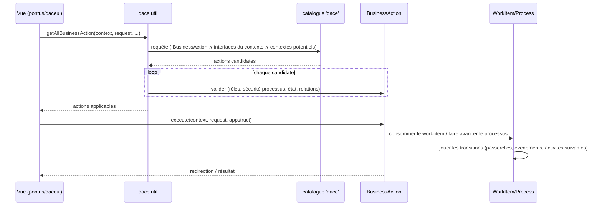
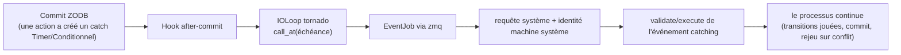

# DaCE — architecture et conception

*Document de conception, phase 2 de la feuille de route de modernisation. Décrit le moteur **tel qu'il est** dans la base legacy (ère Python 3.6) ; les cibles de modernisation sont signalées en ligne. English version: [`../en/architecture.md`](../en/architecture.md).*

## 1. Ce qu'est DaCE

DaCE est un **moteur de workflow centré sur les données** : les processus métier sont décrits déclarativement en Python (un métamodèle de type BPMN — activités, passerelles, événements, transitions), instanciés et exécutés contre des **objets de collaboration** (le contenu du domaine : une idée, une proposition, un utilisateur…), persistés dans la **ZODB** via substanced, et découverts/interrogés via un **catalogue hypatia** dédié. Un petit **réacteur** (IOLoop tornado + worker zmq, tous deux destinés à être remplacés par `asyncio` en phase 3) réveille le moteur pour les événements temporels et conditionnels et pour les processus système.

Le trait signature du moteur — et la raison pour laquelle l'interface de nova-ideo semble « vivante » — est que **les actions disponibles sur un objet sont calculées par le moteur**, jamais codées en dur dans les vues : une vue demande *« quelles actions métier s'appliquent à cet objet, pour cet utilisateur, dans cet état ? »* et affiche ce qui revient.

## 2. Les couches

**Câblage.** `pyramid.includes = dace` déclenche `dace.includeme(config)` : un `config.scan()` (qui enregistre les définitions de processus et les adaptateurs de catalogue déclarés via venusian), l'inclusion de `dace.system` (qui abonne `start_ioloop` à `IDatabaseOpenedWithRoot` : le réacteur démarre à l'ouverture de la ZODB), et l'enregistrement des **étapes d'évolution** (`process_definitions_evolve`, `update_catalogs_evolve`, `remove_unique_process_instances_evolve`, nettoyage du catalogue de relations) utilisées pour migrer schémas et définitions via le mécanisme evolve de substanced.

## 3. Le métamodèle (côté définition)

Les définitions de processus sont du Python ordinaire, construites à l'import et synchronisées dans le site au démarrage ou à l'évolution (`root['process_definition_container']`).

Notes ancrées dans le code :

- Les identifiants de nœuds sont les **noms des arguments nommés** passés à `defineNodes(...)` ; les transitions les référencent par nom (`TransitionDefinition('s', 'g1')`).
- `_normalize_definition()` s'exécute à l'enregistrement : les événements de début/fin manquants sont normalisés, les nœuds orphelins détectés — une définition est toujours bien formée à l'exécution.
- `isUnique` marque les processus singletons (typiquement les **processus système**) ; l'étape `remove_unique_process_instances_evolve` purge leurs instances périmées en migration.
- `EventKindDefinition` porte la sémantique de l'événement : `TimerEventDefinition` (échéance calculée par un callable), `ConditionalEventDefinition` (prédicat réévalué par le réacteur), `SignalEventDefinition` (lancé/attrapé par référence), `TerminateEventDefinition`.
- `InclusiveGateway` n'existe qu'en **souche** (`pass`) côté runtime : seules les passerelles exclusives et parallèles sont implémentées. Toute documentation ou tout modèle laissant supposer le support des passerelles inclusives relève de l'intention, pas du réel.

## 4. Le runtime (côté instance)

Mécanique clé :

- **`Transaction` (dans `dace.processdefinition.core`) n'est *pas* une transaction de base de données.** C'est la comptabilité d'exécution des chemins du moteur : quels chemins du graphe sont ouverts, quelles sous-transactions une passerelle a bifurquées, quelles décisions sont en attente. La renommer (p. ex. `PathTransaction`) est un candidat de phase 3, précisément parce que l'homonymie avec `transaction`/ZODB est une source récurrente de confusion.
- **`StartWorkItem` est virtuel** : avant qu'une instance de processus existe, le moteur calcule les *chemins démarrables* depuis les définitions et les matérialise en work-items de départ. `consume()` instancie le vrai `Process` et rejoue le chemin choisi. C'est pourquoi un utilisateur peut voir et déclencher « créer une idée » alors qu'aucune instance du processus `ideamanagement` n'existe encore.
- **Passerelles** : `ParallelGateway.find_executable_paths` bifurque/fusionne les chemins ; `ExclusiveGateway` produit des `UserDecision` — des chemins alternatifs offerts simultanément, dont la consommation de l'un **annule les frères** (`finish_decisions`).
- **`ExecutionContext`** enregistre les entités *impliquées dans* / *créées par* une instance de processus (avec historique et sous-contextes pour les sous-processus) — la matière première du popup « historique du processus » rendu par daceui.
- **Verrouillage** (`dace.processinstance.lock`, plus le patch `substanced.locking`) : empêche deux utilisateurs de consommer simultanément la même décision ou le même work-item.

## 5. Actions métier : découverte, sécurité, exécution

Une action métier (`BusinessAction`, généralement via ses déclinaisons `InfiniteCardinality` / `ElementaryAction` / `LimitedCardinality`) lie un **behavior** à une activité d'un processus, applicable à une **interface de contexte** (p. ex. `Iidea`), gardée par jusqu'à quatre validateurs :

| Validateur | Question à laquelle il répond |
|---|---|
| `roles_validation` | l'utilisateur courant porte-t-il les rôles requis (éventuellement locaux au contexte) ? |
| `processsecurity_validation` | les règles de niveau processus l'autorisent-elles (quotas, configuration du site, propriété…) ? |
| `state_validation` | le contexte est-il dans un état compatible (`'to work' in context.state`…) ? |
| `relation_validation` | les relations requises entre processus et contexte sont-elles en place ? |

La découverte est **pilotée par le catalogue**. `dace.util.getAllBusinessAction(context, request, process_id=, node_id=, isautomatic=, action_type=…)` interroge le catalogue `'dace'` : `object_provides = IBusinessAction` ∧ `context_id ∈ interfaces fournies par le contexte (IRO complet)` ∧ `potential_contexts_ids ∈ {'any', oid(context)}`, puis exécute les validateurs sur chaque candidat. Les vues indexées (`DaceCatalogViews`) exposent `process_id`, `node_id`, `states`, `isautomatic`, `issystem`, `context_provides`, … — ce qui rend aussi bon marché le rendu des panneaux daceui et des écrans nova-ideo.

`ActionType` distingue les actions **manuelles** (rendues en boutons/formulaires), **automatiques** (exécutées par le moteur quand atteintes) et **système** (exécutées par le réacteur sous l'identité de la machine système).

## 6. Événements et réacteur

Le comportement temporel et conditionnel repose sur trois pièces coopérantes (dans `dace.subscribers`, `dace.processinstance.event`, `dace.util`) :

- une **IOLoop tornado** dans un thread dédié (timeout de poll abaissé à 0,2 s par `dace.patches`), démarrée sur `IDatabaseOpenedWithRoot` ;
- un **consommateur de jobs alimenté par zmq** (thread `ConsumeTasks`) : tout travail du moteur hors requête utilisateur est enveloppé dans un `Job`/`EventJob` (de `dace.util`), qui monte sa propre requête et son site, s'exécute sous l'identité de la **machine système**, commite, et **rejoue en cas de conflit ZODB** ;
- un **ordonnancement après commit** : `push_event_callback_after_commit(event, callback, params, deadline)` enregistre un hook after-commit ZODB — un événement n'est armé qu'une fois durablement commitées les données qui l'ont créé — puis le callback est planifié sur l'IOLoop à son échéance.

Au redémarrage de l'application, `start_intermediate_events` réarme les événements catching en attente trouvés en base — les échéances survivent aux redémarrages. Les gestionnaires `SIGINT`/`SIGTERM` arrêtent proprement la boucle et le consommateur.

**Note phase 3.** Ce réacteur est la cible de remplacement désignée : tornado < 4 et pyzmq 14 sont les pièces mobiles les plus anciennes de la pile. Le plan de migration : `asyncio` derrière la *même* surface d'API (`push_event_callback_after_commit`, `Job`/`EventJob`, `start_ioloop`/`stop_ioloop`), validée par les tests signal/timer existants.

## 7. Objets de collaboration, relations, rôles

- `Object(Folder)` marie l'arbre de ressources substanced avec des **descripteurs de relations déclaratifs** (`dace.descriptors`) : `CompositeUniqueProperty`, `CompositeMultipleProperty`, `SharedUniqueProperty`, `SharedMultipleProperty`. *Composite* implique contenance et propriété du cycle de vie ; *shared* est une référence ; les deux entretiennent automatiquement l'extrémité **opposée** et se manipulent uniformément via `getproperty` / `setproperty` / `addtoproperty` / `delfromproperty`. `set_data`/`get_data` font le pont entre appstructs colander et propriétés (la couche formulaires pontus s'y adosse).
- `Entity(Object)` ajoute `state` (une `PersistentList` — une entité peut être dans plusieurs états à la fois, p. ex. `['submitted_support', 'published']`) et la propriété dynamique `actions`.
- **Rôles** (`dace.objectofcollaboration.principal.util`) : `grant_roles`/`revoke_roles`/`has_role` gèrent rôles *globaux* et rôles *locaux à un contexte* (`('Owner', obj)`), une hiérarchie supérieurs/inférieurs (`_get_allsuperiors`), et `get_access_keys(user)` — les clés précalculées que les requêtes de catalogue utilisent pour filtrer ce qu'un utilisateur peut voir, à l'échelle.

## 8. Persistance, évolution, monkey-patches

- Tout est objet persistant en ZODB ; les **dotted names des modules sont gelés** pendant la modernisation pour garder les pickles existants chargeables.
- Les **étapes d'évolution** livrées par `dace/__init__.py` gèrent les changements de définitions : `process_definitions_evolve` resynchronise `root['process_definition_container']` avec le code (et avertit, dans son propre message de log, qu'un **redémarrage de l'application est obligatoire** ensuite, pour reconstruire les rétro-références `node_definition` portées par les classes de contenu), puis relance `update_catalogs_evolve` (mise à jour des index + réindexation).
- `dace/patches.py` porte exactement **trois** monkey-patches, tous motivés par la performance/latence : timeout de poll tornado abaissé à 0,2 s (réactivité des événements) ; `substanced.objectmap.ObjectMap._find_resource` remplacé par un parcours direct de BTree (l'original passait par `pyramid.traversal`, créant une Request par résolution) ; `substanced.locking._get_lock_service` court-circuité via le `find_service` de dace. Ils sont documentés dans le module lui-même et devront être réévalués à l'arrivée du fork substanced (phase 3).

## 9. Carte de lecture

| Pour comprendre… | Lire |
|---|---|
| le métamodèle | `processdefinition/processdef.py`, `core.py`, `eventdef.py` |
| l'exécution des chemins et les décisions | `processinstance/core.py` (`Transaction`, `MakerFlowNode`), `gateway.py`, `workitem.py` |
| les actions métier | `processinstance/activity.py`, `util.py` (`getAllBusinessAction`) |
| le réacteur | `subscribers.py`, `processinstance/event.py`, `util.py` (`Job`/`EventJob`), `patches.py` |
| objets du domaine et relations | `objectofcollaboration/object.py`, `entity.py`, `descriptors/` |
| rôles et visibilité | `objectofcollaboration/principal/util.py`, `catalog/__init__.py` |
